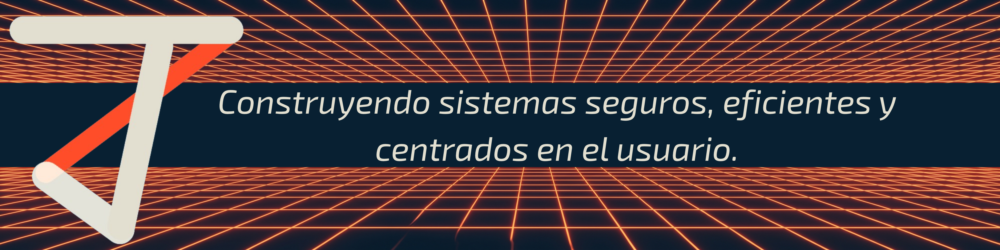

  

# ¡Hola! Soy Jeronimo Pineda 👋

### 👨‍💻 Ingeniero de Sistemas y Computación | Backend, Seguridad & IA

Soy un desarrollador apasionado por resolver problemas complejos mediante **código limpio, arquitecturas escalables y seguridad desde el diseño**. Recientemente graduado de la Universidad de Los Andes (2026), mi objetivo profesional es aportar valor inmediato como Desarrollador Junior / Full Stack, con la visión a largo plazo de liderar ecosistemas tecnológicos como ingeniero **DevSecIA Ops**.

Me especializo en la intersección entre el desarrollo backend tradicional, la protección de datos sensibles y la orquestación de modelos de Inteligencia Artificial.

### 🚀 ¿Qué estoy haciendo ahora?

* 💻 Contribuyo en mis tiempos libres como **Líder Técnico** para la Iglesia Cristiana Camino de Adoración y Santidad (ICCAS) y la Fundación Camino a la Transformación.
* 🔒 Liderando la modernización tecnológica y la seguridad de la información organizacional, implementando arquitecturas seguras alineadas con la norma ISO/IEC 27001 y la Ley 1581 de protección de datos.
* 🌱 Explorando de forma constante prácticas de **DevSecOps** e integración de modelos de Inteligencia Artificial para el análisis de datos.

### 🛠️ Tech Stack & Herramientas

* **Lenguajes:** Python, Java
* **Backend & Frameworks:** Django, Django Ninja, Spring Boot, Nest.JS
* **Bases de Datos:** PostgreSQL
* **Seguridad & DevOps:** Git, Docker, WSL2 (Debian), SonarQube, Autenticación (JWT/HMAC), Cifrado Simétrico (Fernet)
* **Inteligencia Artificial:** LangChain, LLMs (OpenAI/Vertex AI), Ollama

### 🏆 Proyecto Destacado

#### 🏢 Sistema de Gestión y Seguridad (ICCAS / Fundación)
Plataforma Full Stack en desarrollo activo diseñada para modernizar la infraestructura de ambas organizaciones, garantizando la integridad, disponibilidad y confidencialidad de la información.

* **Logros Tecnológicos:** Migración exitosa de registros no estructurados (Excel) a una base de datos relacional centralizada.
* **Arquitectura de Seguridad:** Implementación de cifrado simétrico a nivel de base de datos (Fernet), desarrollo de APIs REST seguras protegidas con Ninja JWT, validaciones HMAC y patrones de borrado lógico (*soft-deletion*).
* **Stack:** Python, Django, Django Ninja, PostgreSQL, psycopg2-binary, python-decouple.

### 📬 Conecta conmigo

Si estás buscando un desarrollador apasionado por el código seguro y la IA, ¡me encantaría hablar contigo!

* 💼 **LinkedIn:** [linkedin.com/in/jeronimo-a-pineda-cano](https://linkedin.com/in/jeronimo-a-pineda-cano/)
* 📧 **Email:** 20jarnulfo@gmail.com
